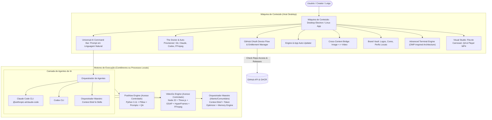
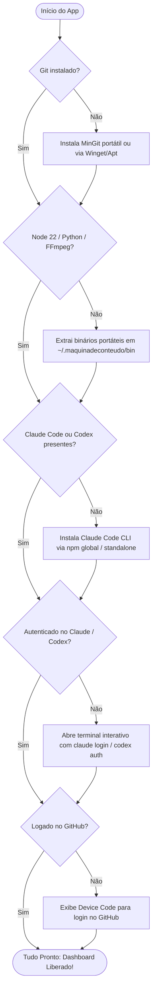
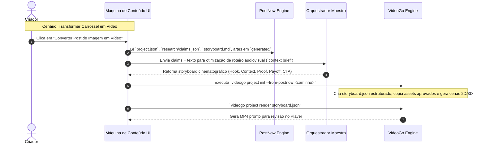

# Arquitetura — Máquina de Conteúdo

Sistema desktop unificado (Windows e Linux) para criação, gestão, renderização e revisão de conteúdo em imagem e vídeo, integrando três motores especializados via contêineres/daemons locais, autenticação por GitHub, economia cirúrgica de tokens e interface híbrida (Terminal + Visual Studio).

Projetado para operar tanto por desenvolvedores via terminal quanto por usuários leigos (criadores, agências, social media) que operam via linguagem natural suportada por **Codex** e **Claude Code**, com zero atrito de instalação e automação de pré-requisitos.

---

## 1. Visão Geral e Ecossistema

A **Máquina de Conteúdo** atua como uma central de produção de ativos digitais alimentada por 3 pilares:



### Os Três Contêineres / Motores

1. **PostNow Engine (`github.com/FernandoBolzan/PostNow`)** [Acesso Controlado]:
   - **Papel**: Criação assistida de posts de imagem, carrosséis estruturados (10 páginas), stories, gestão de marcas/clientes (logos oficiais, fontes, paletas), pesquisa de claims e contact-sheet para QA humano.
   - **Ambiente**: Python 3.11+, Pillow, CLI `postnow`.
   - **Interface**: Execução de comandos CLI via PTY/JSON stream + API HTTP interna local (porta `4120`).

2. **VideoGo Engine (`github.com/FernandoBolzan/VideoGo`)** [Acesso Controlado]:
   - **Papel**: Planejamento, roteirização, animação 2D (HTML/GSAP/HyperFrames), cenas 3D procedurais (Three.js), transcrição de footage (Whisper local), cortes e renderização determinística de vídeo em MP4 (1080x1920 Reels, 1920x1080 YouTube, 1080x1080).
   - **Ambiente**: Node 22+, Three.js, GSAP, FFmpeg, Python 3.11 (Motion / faster-whisper), CLI `videogo`.
   - **Interface**: Execução CLI + API HTTP interna local (porta `4121`).

3. **Orquestrador Maestro (`github.com/IAPro-Community/Orquestrador-Maestro`)** [Aberto / Open Source]:
   - **Papel**: Motor de persistência de inteligência, assembly de contexto cirúrgico (`context brief`), roteamento semântico de skills e economia ativa de tokens para os outros dois motores.
   - **Ambiente**: Node.js, CLI `orquestrador-maestro`, bridge stdio/HTTP (porta `4122`).
   - **Interface**: CLI JSON output + Bridge stdio / HTTP local.

---

## 2. Autenticação, Entitlement e Atualizador via GitHub

### Fluxo de Login: GitHub OAuth Device Flow
Para evitar expor `client_secret` no binário desktop ou exigir que o usuário crie servidores web de callback:
1. O app solicita um `device_code` à API do GitHub (`https://github.com/login/device/code`).
2. A tela exibe um código alfanumérico curto (ex: `WDHB-4821`) e o botão "Abrir GitHub para Autorizar" (`https://github.com/login/device`).
3. O app faz polling seguro do token de acesso (`access_token`).
4. O token é armazenado criptografado no cofre do sistema operacional (`keytar` / OS Keychain no Linux / DPAPI no Windows).

### Verificação de Acesso (Entitlement Gate)
Com o token do usuário:
- **Repositório Aberto**: `IAPro-Community/Orquestrador-Maestro` -> Sempre acessível e clonável/puxável.
- **Repositórios de Acesso Controlado**: `FernandoBolzan/PostNow` e `FernandoBolzan/VideoGo`:
  - O app consulta `GET /repos/FernandoBolzan/PostNow` e `GET /repos/FernandoBolzan/VideoGo`.
  - Se `permissions.pull == true`: o usuário possui acesso válido e o app libera o download/atualização do motor correspondente.
  - Se `status == 404` ou sem permissão: o app exibe status "Sem licença/acesso liberado neste repositório" com link para solicitar permissão ao mantenedor.

### Sistema de Atualização Unificado
1. **Atualização dos Motores**:
   - Modo Contêiner: `docker pull ghcr.io/fernandobolzan/postnow:latest` e `docker pull ghcr.io/fernandobolzan/videogo:latest` autenticado via token GitHub no registry `ghcr.io`.
   - Modo Git Local (opcional/desenvolvedor): `git pull origin main` em subpastas de runtime gerenciadas pela aplicação (`~/.maquinadeconteudo/engines/`).
2. **Atualização do App Desktop**:
   - Fonte: release estável mais recente em `github.com/FernandoBolzan/maquina-de-conteudo-studio`, consultada por `electron-updater` via provider GitHub e metadados `latest*.yml` anexados à release.
   - Versão SemVer em `package.json`; tags anotadas `v<MAJOR.MINOR.PATCH>` disparam `.github/workflows/release.yml`, que constrói os alvos nativos e publica os artefatos após todos passarem.
   - Usuário verifica na Configuração e confirma download/reinício; não há download nem instalação silenciosos. Linux AppImage autoatualiza; `.deb` usa atualização pelo sistema.

---

## 3. The Doctor & Auto-Provisioner (Experiência Zero-Setup para Leigos)

Para que qualquer usuário leigo consiga usar a Máquina de Conteúdo sem configurar ambientes manualmente, o aplicativo possui um motor embutido de autodiagnóstico e provisionamento (**Doctor Engine**):



---

## 4. Universal AI Command Bar (Linguagem Natural -> Linha de Produção)

O leigo interage através de uma barra de comando conversacional inteligente:
- *"Crie um carrossel para a Dra. Camila sobre 5 sinais de bruxismo infantil com tom acolhedor."*
- *"Gera 3 opções de gancho visual para a capa e me mostra no mosaico."*
- *"Achei a página 4 longa demais, resume em 3 tópicos curtos."*
- *"Transforma esse carrossel aprovado num Reels de 30 segundos com voz dinâmica e gráficos 3D."*

---

## 5. Interface Híbrida: "Meio Terminal, Meio Visual"

A estética segue o estilo **Cyber-Workbench / Hacker Studio** (Dark mode industrial, paleta de alto contraste, tipografia mono para dados e comandos, UI visual rica para mídias).

```
+-----------------------------------------------------------------------------------------------+
| [MÁQUINA DE CONTEÚDO]  👤 github: FernandoBolzan  [⚡ 3 Motores Prontos]  [Tokens: -34% Eco]   |
+---------------------+---------------------------------------------------+---------------------+
| 📁 BRAND VAULT &    | 🎨 VISUAL WORKSPACE (Central)                     | 📊 STATUS & AÇÕES   |
|    PROJETOS         |                                                   |                     |
| > Clientes          | [Modo Imagem: Carrossel PostNow]                  | Cliente: Dra. Camila|
|   v Dra. Camila     | +--------+ +--------+ +--------+ +--------+       | Projeto: Bruxismo-01|
|     * Post-01 [IMG] | | Capa   | | Pág 02 | | Pág 03 | | CTA 10 |  ...  | Tipo: Carrossel     |
|     * Reels-01[VID] | | [IMG]  | | [IMG]  | | [IMG]  | | [IMG]  |       | QA: 10/10 Aprovado  |
|   > Cliente Beta    | +--------+ +--------+ +--------+ +--------+       |                     |
|                     |                                                   | [⚡ GERAR REELS     |
| [+ Novo Cliente]    | [Modo Vídeo: VideoGo Timeline & Review]           |    DO CARROSSEL]    |
| [+ Nova Ideia (IA)] | [ > Player MP4 (1080x1920) ]   [ Storyboard ]     |                     |
|                     | 00:00 [== Hook ==|== Prova ==|== CTA ==] 00:45    | [Exportar Pacote]   |
+---------------------+---------------------------------------------------+---------------------+
| 💻 CONSOLE DE EXECUÇÃO & TERMINAL AGENTIC (xterm.js + OMP Architecture)                       |
| ╭─ Claude Code ───────────────────────────────────────────────────────────── [12.5 fps ⠋] ─╮ |
| │ > Mapeando 10 lâminas do PostNow em 6 cenas no VideoGo...                                │ |
| │ [Orquestrador Maestro]: Contexto sintetizado (Hook: 4s | Prova 3D: 18s | CTA: 5s).       │ |
| ╰──────────────────────────────────────────────────────────────────────────────────────────╯ |
| $ videogo project render storage/projects/camila-bruxismo/storyboard.json --voice demo        |
| [RENDER GPU] [████████████████████████░░░░░░] 78% (Frame 702/900) - ETA: 4s                  |
+-----------------------------------------------------------------------------------------------+
```

---

## 6. Arquitetura Avançada do Terminal (Inspirada no OMP)

Para atingir o nível de robustez e sofisticação do **omp**, o terminal da Máquina de Conteúdo adota 6 pilares de engenharia inspirados diretamente no subsistema de terminal e TUI do `omp`:

### 6.1. Contrato Diferencial: History vs. Mutable Viewport
- **O Problema**: Em terminais comuns, o FFmpeg ou HyperFrames imprimem milhares de linhas de progresso de frames, poluindo o histórico e travando a renderização gráfica do Electron.
- **A Solução omp**:
  - **Mutable Viewport**: Linhas ativas em mutação (barras de progresso do FFmpeg, contadores de frames, status de download, spinners) são atualizadas estritamente na viewport volátil via diff diferencial.
  - **Immutable History**: Somente após o comando terminar com sucesso, uma linha resumida estável é emitida para o histórico permanente (`HistoryBatch` com ID monotônico). O histórico do usuário permanece limpo e ultra veloz.

### 6.2. Backpressure e Bounded Chunks no PTY
- **O Problema**: Quando um comando solta dezenas de megabytes de logs ou stderr de uma vez só, o Electron congela a interface (IPC inundado).
- **A Solução omp** (`pi-natives` / PTY):
  - Fila delimitada de 64 chunks para dados vindos do PTY.
  - Se o frontend React estiver ocupado renderizando, o leitor nativo pausa a leitura e aplica backpressure no processo filho, protegendo a memória do aplicativo.
  - Decodificação UTF-8 incremental: streams de bytes divididos na borda de caracteres multibyte não quebram acentos ou emojis em português.

### 6.3. Encerramento Confiável de Processos Filhos (`killTree`)
- **O Problema**: Quando o usuário clica em "Cancelar" ou "Parar Render", o processo do shell morre, mas instâncias de `ffmpeg`, `whisper` ou `python` continuam rodando em segundo plano consumindo 100% de CPU.
- **A Solução omp**:
  - Implementação de encerramento em cascata `children-first`:
    1. Localiza a árvore de processos descendentes por PID/GroupId (`Process.fromPid`).
    2. Envia sinal `SIGTERM` / término educado com janela de 1000ms.
    3. Se não encerrar, dispara `SIGKILL` / `TerminateProcess` forçado em todos os filhos antes de liberar a sessão.

### 6.4. Tool Cards Semânticos e Status Line
- Em vez de texto cru jogado no terminal, os comandos de IA são encapsulados em **Tool Cards**:
  - Borda arredondada suave com junction glyphs (`╭╮╰╯` e `├┤┬┴┼`).
  - Cabeçalho com status semântico (`pending`, `success`, `error`) e spinner dinâmico em 12.5 fps / 30 fps.
  - Modo colapsado por padrão para leigos (exibe apenas: `✓ 10 lâminas geradas para Dra. Camila`) com toggle `[Ver Detalhes]` para desenvolvedores que queiram inspecionar stdout/stderr completo.
  - **Status Line Segmentada** no rodapé do terminal:
    - Segmento de Modelo: `claude-sonnet-4-5` / `codex`
    - Segmento de Tokens: `Tokens: 2.4k (-42% eco)`
    - Segmento de GPU: `NVENC / VAAPI Ativo`

### 6.5. Miniaturas de Mídia Inline no Terminal
- Inspirado no suporte a Kitty Graphics / TSP do omp:
  - O terminal exibe miniaturas das imagens do carrossel geradas pelo PostNow e os frames-chave do vídeo gerados pelo VideoGo diretamente entre os logs de execução.
  - O usuário vê visualmente o resultado preliminar antes mesmo de abrir o visualizador de tela cheia.

### 6.6. Barramento Estruturado JSONL RPC para Cancelamento e Direcionamento
- A comunicação entre o Electron e os processos de IA não é feita por regex frágil na tela, mas através de um canal JSONL sobre stdio (como o RPC do omp):
  - `prompt`: envio atômico de intenção.
  - `steer`: interrupção e ajuste de rota enquanto o agente está trabalhando.
  - `abort_and_restore_queue`: cancelamento atômico que devolve o texto do usuário para a caixa de edição sem perder o raciocínio.

---

## 7. O "Content Bridge": Interoperabilidade Imagem <-> Vídeo

O diferencial exclusivo da Máquina de Conteúdo é o conversor estrutural de conteúdo:



---

## 8. Orquestrador Maestro: Economia de Tokens e Inteligência Compartilhada

O motor do Orquestrador Maestro age como o guardião de eficiência:
1. **Context Briefing Cirúrgico**: Em vez de enviar briefings gigantescos com MBs de histórico para o modelo, ele extrai exclusivamente a voz da marca, o objetivo do post e os fatos validados via `context brief`.
2. **Zero Hallucination em Claims**: Os dados técnicos pesquisados em `research/claims.json` são congelados como fontes canônicas; a IA não inventa dados numéricos ou estatísticas.
3. **Telemetria de Economia**: Exibição em tempo real na barra de status do app com a métrica de tokens poupados comparado a prompts brutos sem compressão de contexto.

---

## 9. Arquitetura de Dados e Persistência Local

Estrutura local no computador do usuário (`~/MaquinaDeConteudo/`):

```
~/MaquinaDeConteudo/
├── config/
│   ├── settings.json          # Preferências do usuário, temas, paths
│   └── auth.json              # Credenciais criptografadas (GitHub OAuth token)
├── bin/                       # Binários portáteis mantidos pelo Doctor (FFmpeg, Python)
├── engines/
│   ├── docker-compose.yml     # Orquestração dos 3 contêineres
│   └── runtimes/              # Checkouts locais gerenciados automaticamente
├── storage/
│   ├── clients/               # Brand Vault: logos oficiais, diretrizes e paletas
│   │   └── dra-camila/
│   │       ├── profile.json
│   │       └── assets/
│   └── projects/              # Projetos organizados por slug
│       ├── bruxismo-carousel/ # Projeto PostNow (Imagem)
│       └── bruxismo-reels/    # Projeto VideoGo (Vídeo)
└── cache/                     # Previews temporários, frames e render cache
```

---

## 10. Stack Técnica e Empacotamento

- **Desktop Host**: Electron + TypeScript + Vite.
- **Frontend UI**: React 19 + Tailwind CSS + Lucide Icons + Radix UI.
- **Terminal Engine**: `xterm.js` + `@xterm/addon-fit` + `@xterm/addon-webgl` conectado a PTY local com backpressure e renderização diferencial.
- **Engine Runner**:
  - `EngineDriver` híbrido (Docker Compose ou Subprocess Runner local).
- **Formatos de Empacotamento**:
  - Windows: Instalador NSIS (`.exe`) com modo portátil sem necessidade de privilégios de administrador.
  - Linux: AppImage autocontido e pacote `.deb`.
