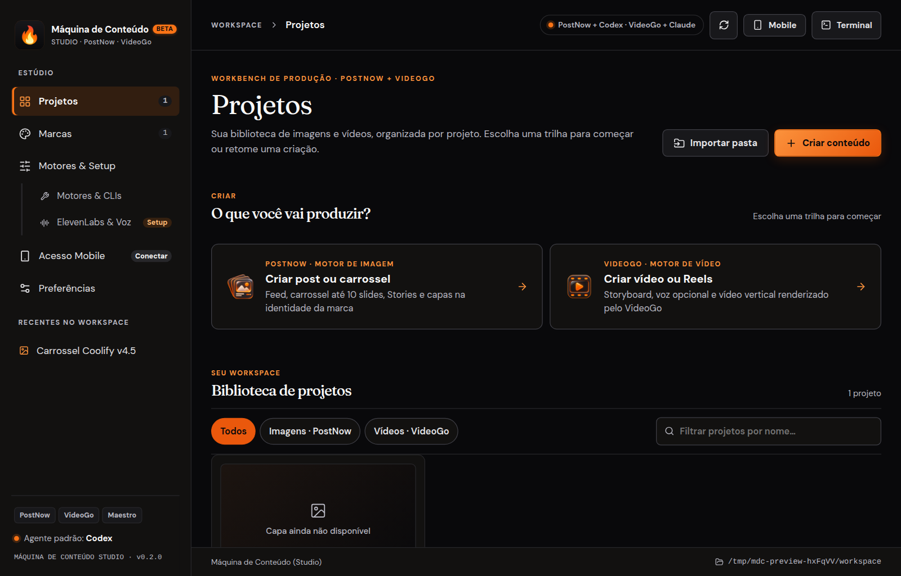
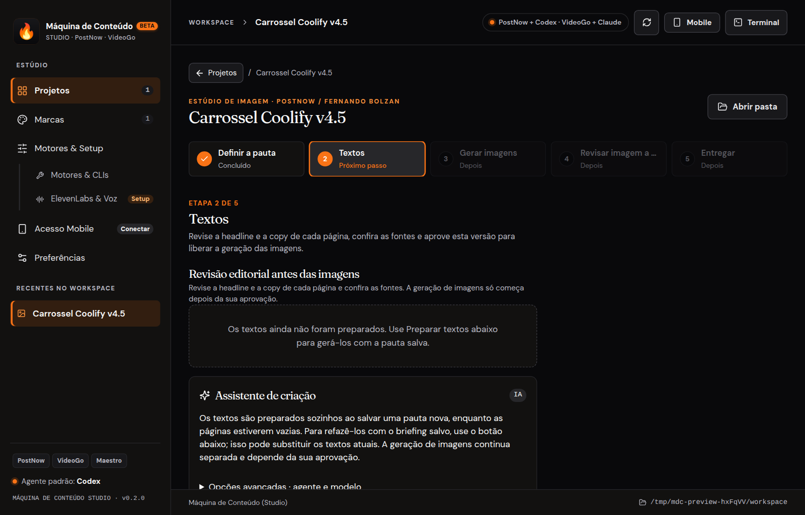
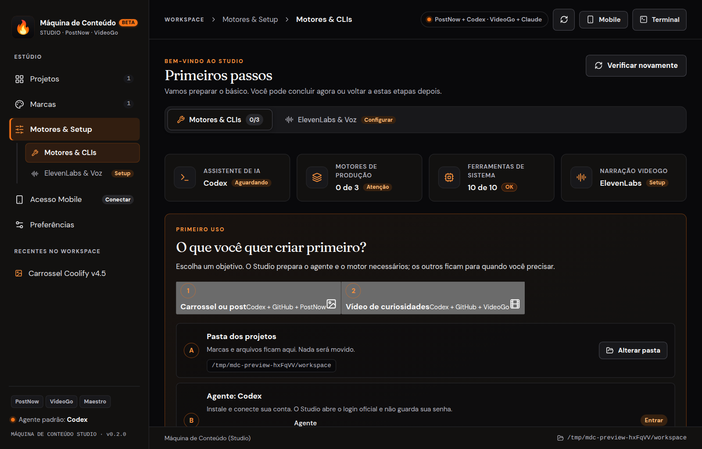
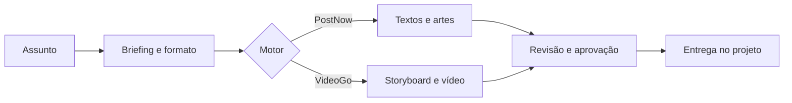

<h1 align="center">Máquina de Conteúdo Studio</h1>

<p align="center"><strong>Transforme um assunto em carrossel, post, Reels e vídeo, revisando cada etapa antes de publicar.</strong></p>

<p align="center">
  <a href="https://github.com/FernandoBolzan/maquina-de-conteudo-studio/releases/tag/v0.2.2"></a>
  
  
  <a href="https://www.fernandobolzan.com/maquina-de-conteudo"></a>
</p>

<p align="center">
  <a href="https://github.com/FernandoBolzan/maquina-de-conteudo-studio/releases/download/v0.2.2/maquina-de-conteudo-0.2.2-x64.exe"><strong>Windows</strong></a> ·
  <a href="https://github.com/FernandoBolzan/maquina-de-conteudo-studio/releases/download/v0.2.2/maquina-de-conteudo-0.2.2-arm64.dmg"><strong>macOS</strong></a> ·
  <a href="https://github.com/FernandoBolzan/maquina-de-conteudo-studio/releases/download/v0.2.2/maquina-de-conteudo-0.2.2-x86_64.AppImage"><strong>Linux</strong></a> ·
  <a href="https://github.com/FernandoBolzan/maquina-de-conteudo-studio/releases/tag/v0.2.2"><strong>Todas as versões</strong></a>
</p>

<br>

<p align="center">
  
</p>

<table>
  <tr>
    <td width="50%"></td>
    <td width="50%"></td>
  </tr>
</table>

## O que é

Um estúdio de conteúdo que roda no seu computador. Você escreve o assunto; o Studio organiza o briefing, cria textos, imagens e vídeos com os motores e assistentes de IA que você conectou, e só entrega o que você aprovou etapa por etapa.

- **Carrossel, post e Story** com o motor **PostNow**: textos revisados, imagens geradas pelo Codex, logo oficial aplicada e formato fechado.
- **Vídeo** com o motor **VideoGo**: storyboard, narração por cena, composição animada e render 1080×1920 local.
- **Voz**: narração com ElevenLabs (com a sua chave), áudio próprio por cena ou gravação no Modo Studio.
- **Assistentes**: Claude Code e Codex, sempre pelo CLI oficial de cada um. O Studio não guarda suas senhas.

## Como funciona

1. **Crie um projeto** em *Projetos → Criar conteúdo*, escolha PostNow ou VideoGo e informe o assunto.
2. **Revise cada etapa**: textos, roteiro e narração. O botão **Avançar** aprova a etapa e abre a próxima.
3. **Gere** imagens, capas, áudio e vídeo. Cada ação mostra o progresso ao vivo.
4. **Entregue**: os arquivos finais ficam dentro do projeto, com aprovações vinculadas ao conteúdo.



## Downloads (v0.2.2)

| Sistema | Arquivo | Como instalar |
|---|---|---|
| Windows x64 | [`.exe`](https://github.com/FernandoBolzan/maquina-de-conteudo-studio/releases/download/v0.2.2/maquina-de-conteudo-0.2.2-x64.exe) | Execute o instalador. O SmartScreen pode avisar: **Mais informações → Executar assim mesmo**. |
| macOS Apple Silicon | [`.dmg`](https://github.com/FernandoBolzan/maquina-de-conteudo-studio/releases/download/v0.2.2/maquina-de-conteudo-0.2.2-arm64.dmg) · [`.zip`](https://github.com/FernandoBolzan/maquina-de-conteudo-studio/releases/download/v0.2.2/maquina-de-conteudo-0.2.2-arm64.zip) | Abra e, se o macOS bloquear, vá em **Ajustes do Sistema → Privacidade e Segurança → Abrir mesmo assim**. |
| Linux x86_64 | [AppImage](https://github.com/FernandoBolzan/maquina-de-conteudo-studio/releases/download/v0.2.2/maquina-de-conteudo-0.2.2-x86_64.AppImage) | `chmod +x` no arquivo e execute. |
| Debian/Ubuntu x86_64 | [`.deb`](https://github.com/FernandoBolzan/maquina-de-conteudo-studio/releases/download/v0.2.2/maquina-de-conteudo-0.2.2-amd64.deb) | `sudo apt install ./maquina-de-conteudo-0.2.2-amd64.deb` |

**Atualização automática:** o app baixa novas versões sozinho no Windows e no AppImage, e aplica ao reiniciar (**Preferências → Reiniciar e atualizar**). O `.deb` e os builds de macOS (sem assinatura Apple) são atualizados manualmente.

Não há build para Linux ARM64 nem para Macs Intel nesta versão.

## Motores

| Motor | Papel | Requisitos |
|---|---|---|
| **PostNow** | Projetos de imagem e carrossel, identidade visual e preparo das artes | Python e Pillow |
| **VideoGo** | Projetos de vídeo, narração e renderização | Node.js 22+, FFmpeg, FFprobe, Python 3.11+ |
| **Orquestrador Maestro** | Contexto e orquestração local | Node.js e CLI Maestro |
| **Codex / Claude Code** | Textos, imagens e roteiros por IA | CLI oficial instalado e logado |
| **ElevenLabs** (opcional) | Vozes e clonagem consentida | API key com permissões de voz e Text to Speech |

Em **Motores & Setup** você instala, vincula ou testa cada motor. Instalações e logins pedem confirmação.

## Privacidade

- Projetos, marcas, aprovações e exportações ficam no workspace local que você escolheu.
- Textos, imagens e áudios só saem da máquina quando você inicia uma ação que usa um provedor (Codex, Claude, ElevenLabs). Essas ações podem consumir créditos.
- A chave da ElevenLabs fica no cofre seguro do sistema operacional; sem cofre disponível, ela não é salva.
- Áudios gravados no Modo Studio ficam no projeto e não são enviados a nenhum provedor.

## Limites conhecidos

- Windows e macOS são compilados pelo CI, mas a instalação ainda não foi testada em máquina real.
- Sessões de vídeo consomem a cota de 5 horas da conta Claude.
- Clonagem de voz depende da elegibilidade da conta na ElevenLabs.

Histórico completo em [CHANGELOG.md](CHANGELOG.md).

## Desenvolvimento

Requer Node.js 22 (o mesmo da CI).

```bash
npm ci
npm run dev                                  # terminal 1: Vite
MDC_DEV_URL=http://127.0.0.1:5173 npm start  # terminal 2: Electron
```

Validações:

```bash
npm run typecheck && npm run lint && npm test && npm run smoke && npm run build
```

O smoke usa os diretórios irmãos `../PostNow`, `../VideoGo` e o Maestro. Para outros caminhos, defina `MDC_SMOKE_POSTNOW`, `MDC_SMOKE_VIDEOGO` e `MDC_SMOKE_MAESTRO`.

Build dos instaladores (não publica nada): `npm run dist:linux`, `npm run dist:windows` ou `npm run dist:mac`. O processo de publicação está em [DEV/RUNBOOKS/RELEASES.md](DEV/RUNBOOKS/RELEASES.md).

## Open source e curso

Este repositório é público. O Studio faz parte do curso **[Máquina de Conteúdo](https://www.fernandobolzan.com/maquina-de-conteudo)**.

Licença: ainda não definida (o repositório não tem arquivo `LICENSE`).
